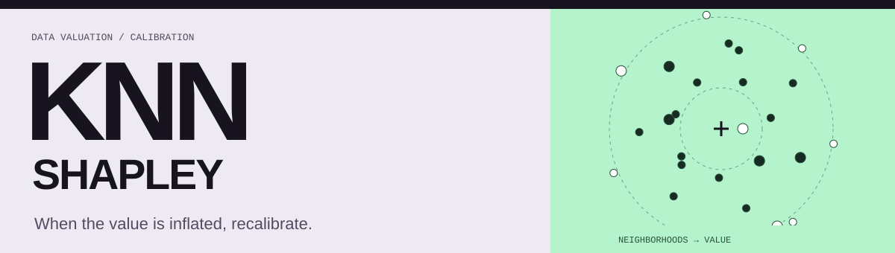

# On the Inflation of KNN-Shapley Value

**Ziao Yang**, Han Yue, Jian Chen, and Hongfu Liu

> **[Read the paper](https://arxiv.org/pdf/2405.17489)** · [arXiv](https://arxiv.org/abs/2405.17489)  
> Calibrated data valuation across image, text, and tabular datasets.



## From data to value

**Configure** [`run_sv.sh`](run_sv.sh) and [`config.py`](config.py).  
**Prepare** datasets with [`prepare_data.py`](prepare_data.py).  
**Evaluate** training-data values with [`sv.py`](sv.py).

```bash
git clone https://github.com/yangziao56/Inflation_KNN-SV.git
cd Inflation_KNN-SV
pip install -r requirements.txt
bash run_sv.sh
```

Review the dataset settings in `run_sv.sh` before launching. Its CKNN configurations cover CIFAR-10, tabular datasets, AG News, SST-2, and 20 Newsgroups.

<details>
<summary><strong>Supporting utilities</strong></summary>

- [`utility_func.py`](utility_func.py)
- [`helper.py`](helper.py)

</details>

<details>
<summary><strong>Citation</strong></summary>

```bibtex
@misc{yang2024inflationknn,
  title = {On the Inflation of KNN-Shapley Value},
  author = {Yang, Ziao and Yue, Han and Chen, Jian and Liu, Hongfu},
  year = {2024},
  eprint = {2405.17489},
  archivePrefix = {arXiv},
  url = {https://arxiv.org/abs/2405.17489}
}
```

</details>
